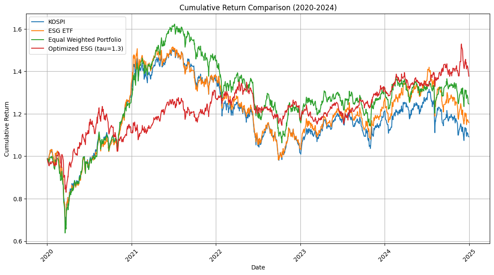
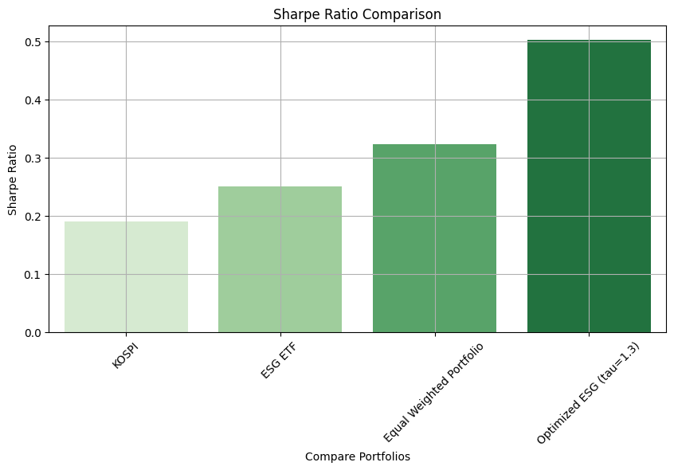
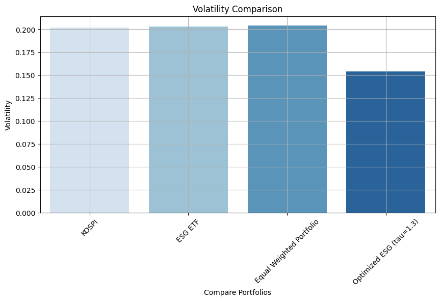
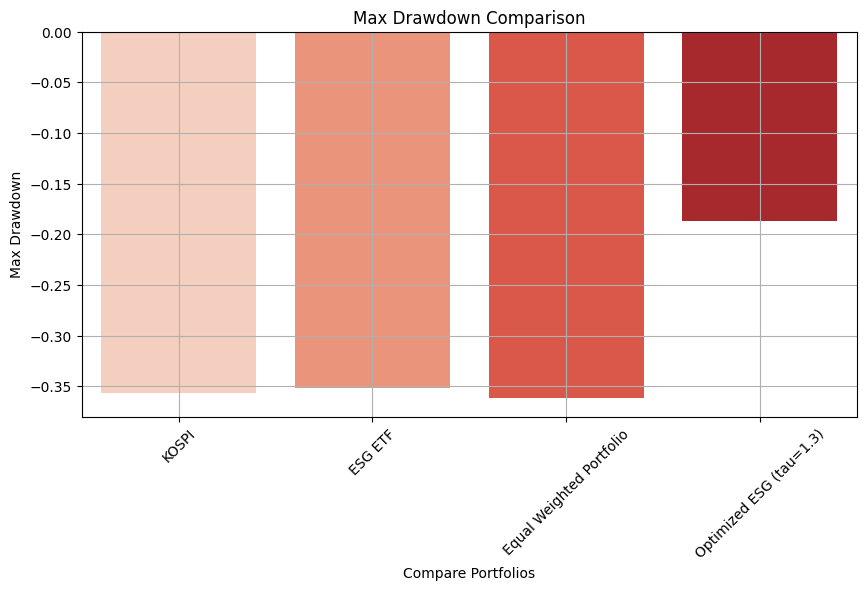
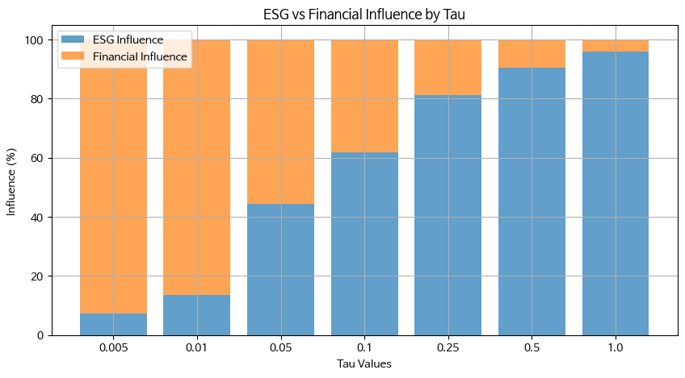

# LEPOS Post-Graduation Research: Backtesting the LLM-ESG Portfolio

> After the graduation exhibition (Nov 2024), the optimization model was refined and
> validated through a series of backtesting experiments (Jan–Mar 2025) conducted for a
> follow-up academic paper under the guidance of the project adviser.
> This document summarizes the methodology and final results. All referenced data files
> and charts live in this directory.

## 1. Research Questions

1. Does a portfolio optimized with **LLM-predicted ESG scores** outperform standard
   benchmarks (KOSPI index, ESG ETF, equal-weighted portfolio) over a 5-year horizon?
2. How should ESG views be injected into the **Black-Litterman** framework so that the
   result stays economically interpretable?
3. What is the optimal strength (`tau`) for blending ESG views against market-implied
   returns?

## 2. Methodology

### 2.1 Improved Black-Litterman view construction

The original graduation-project model collapsed all rating agencies into a single
averaged ESG score and injected it as if it were an expected return. The revised design
keeps each agency's view separate and lets user trust weights modulate them:

- **P matrix (5 × N)** — one row per rating agency (MSCI, S&P, Sustainalytics, ISS,
  KCGS/ESG기준원), where each row contains that agency's ESG scores predicted by a
  GPT-3.5-turbo model fine-tuned to mimic the agency's rating behaviour from news text.
- **Q vector** — `Q = P · user_trust`, i.e. agency views weighted by the investor's
  trust in each agency (uniform trust assumed in the experiments).
- **Ω (Omega)** — investor confidence matrix, allowing biased agencies to be discounted.
- Posterior returns: `μ = τ·Σ·r_m + Pᵀ(Ω⁻¹P)Q` combined with a **Ledoit-Wolf shrunk
  covariance matrix** for numerical stability.

### 2.2 Backtest design

- **Universe**: KOSPI-listed companies covered by the LLM ESG scoring pipeline
  (see [`llm_esg_data.csv`](llm_esg_data.csv)).
- **Period**: 2020–2024, with **annual rebalancing** — the portfolio for year *t* is
  always constructed from year *t−1* ESG scores (look-ahead bias removed in the
  redesigned experiment).
- **Price data**: daily close prices from KRX
  ([`krx_5yr_prices.csv`](krx_5yr_prices.csv)).
- **Constraints**: long-only, per-asset weight cap, weights sum to 1, solved as a
  quadratic program.
- **Benchmarks**: KOSPI index, a Korean ESG ETF, and an equal-weighted portfolio of the
  same universe.

## 3. Results

### 3.1 Benchmark comparison (5-year backtest, 2020–2024)

| Portfolio | 5y Cumulative Return | CAGR | Volatility | Sharpe | Max Drawdown | Calmar |
|---|---|---|---|---|---|---|
| KOSPI | 1.092 | 0.018 | 0.202 | 0.190 | 0.357 | 0.051 |
| ESG ETF | 1.159 | 0.031 | 0.203 | 0.251 | 0.352 | 0.087 |
| Equal-weighted | 1.247 | 0.046 | 0.204 | 0.323 | 0.362 | 0.128 |
| **Optimized ESG (τ = 0.5)** | **1.373** | **0.067** | **0.154** | **0.499** | **0.187** | **0.359** |

The LLM-ESG optimized portfolio dominates every benchmark on every metric: highest
cumulative return with ~25 % lower volatility and roughly half the maximum drawdown.

The τ = 0.5 run is shown because its yearly weights are included in this directory and
its return series is reproduced exactly by [`robustness_backtest.py`](robustness_backtest.py).
The in-sample best τ = 1.3 scored marginally higher (1.377 cumulative, Sharpe 0.503), but
its weight tables were not preserved.

| | | |
|---|---|---|
|  |  |  |

### 3.2 Tau sensitivity and optimization

`tau` controls how strongly ESG views tilt the market-implied returns. A sweep plus
Bayesian optimization (scikit-optimize) over τ ∈ [0.001, 1.0] found CAGR and cumulative
return are maximized near **τ ≈ 0.6**, and the refined τ-grid experiment identified
τ = 1.3 as the volatility-minimizing / Sharpe-maximizing point. Sensitivity is mild
because Ledoit-Wolf shrinkage dampens the effect of τ on the posterior.

The finding that returns keep improving while a substantial ESG tilt is applied supports
the core thesis: **incorporating text-derived ESG signals improves long-horizon,
risk-adjusted performance** rather than sacrificing it.

### 3.3 Reproduction and transaction costs

[`robustness_backtest.py`](robustness_backtest.py) independently rebuilds the return
series from the weight tables and prices in this directory:

| | 5y Cum. Return | CAGR | Volatility | Sharpe | Max DD | Calmar |
|---|---|---|---|---|---|---|
| KOSPI | 1.092 | 0.018 | 0.202 | 0.190 | 0.357 | 0.051 |
| ESG ETF | 1.159 | 0.031 | 0.203 | 0.251 | 0.352 | 0.087 |
| Equal-weighted (buy-and-hold, net of costs) | 1.222 | 0.042 | 0.200 | 0.305 | 0.353 | 0.119 |
| LEPOS τ = 0.5 (study's method) | 1.373 | 0.067 | 0.154 | 0.499 | 0.187 | 0.359 |
| LEPOS τ = 0.5 (buy-and-hold, gross) | 1.330 | 0.060 | 0.153 | 0.457 | 0.182 | 0.330 |
| **LEPOS τ = 0.5 (buy-and-hold, net of costs)** | **1.319** | **0.058** | **0.153** | **0.447** | **0.182** | **0.321** |

- **Reproduction.** Computed the study's way (target weights held every day, no costs),
  the τ = 0.5 series matches the published figures (1.3732 vs 1.3733), as do both
  benchmarks. The equal-weighted series comes out slightly lower than published
  (1.238 vs 1.247); the source of that small gap was not identified.
- **Realistic execution.** The study's method implicitly rebalances daily. An annually
  rebalanced portfolio instead lets weights drift between rebalances, and each rebalance
  pays Korean-market costs (5 bp commission per side + 18 bp securities transaction tax
  on sells). Under these conditions the cumulative return falls from 1.373 to 1.319 —
  about 4 pp from the return method and about 1 pp from costs.
- **Conclusion holds, with a smaller edge.** The portfolio still beats every benchmark on
  every metric, and the risk advantage is essentially unchanged (volatility 0.153 vs
  ≥ 0.200, max drawdown 0.182 vs ≥ 0.352).

**Known limitations** (acknowledged rather than hidden): the universe is today's large
caps (survivorship bias), the window is a single 5-year period, and τ was selected
in-sample. The contribution of the ESG signal itself has not been isolated: a clean
ablation needs the study's optimizer run with the ESG views switched off, and that
optimizer's code is not in this repository.

## 4. Files in this directory

| File | Description |
|---|---|
| `llm_esg_data.csv` | LLM-predicted ESG scores per company/year/agency (Q-vector input) |
| `krx_5yr_prices.csv` | Daily close prices for the universe + benchmarks (KRX) |
| `experiment_results_final.csv` | Hyperparameter sweep (ESG weight × shrinkage × max weight) |
| `investment_weights.csv` | Optimized weights per stock per rebalancing year (τ ≈ 0.6) |
| `portfolio_weights_2020..2024.csv` | Per-year weight tables: equal-weighted, τ = 0.1 and τ = 0.5 runs |
| `portfolio_daily_returns_2020_2024.csv` | Daily returns of experiment vs. benchmark portfolios |
| `*.png` | Result charts (cumulative return, Sharpe, volatility, MDD, Calmar, τ influence) |
| `robustness_backtest.py` | Reproduces §3.3: return reproduction and transaction-cost check |

The multi-year backtest itself was run in a Colab notebook that is not included here.
[`notebooks/06_portfolio_optimization/esg_portfolio_backtest.ipynb`](../../notebooks/06_portfolio_optimization/esg_portfolio_backtest.ipynb)
is an earlier single-period optimization snippet from the same study; it is kept for
reference and does not run as is (it uses a covariance matrix `sigma` defined in another
notebook).

> **Note**: The follow-up paper work was handed over to the adviser after these
> experiments; this directory preserves the reproducible artifacts produced by the team.
